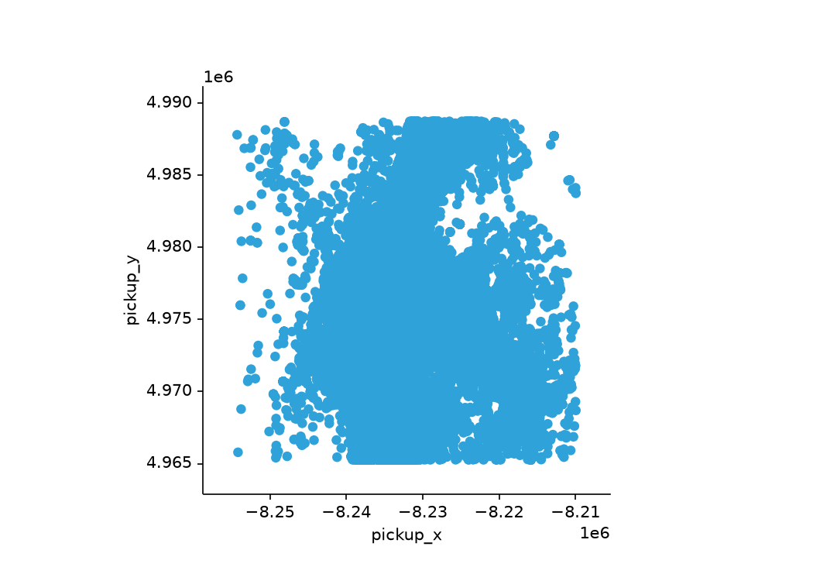
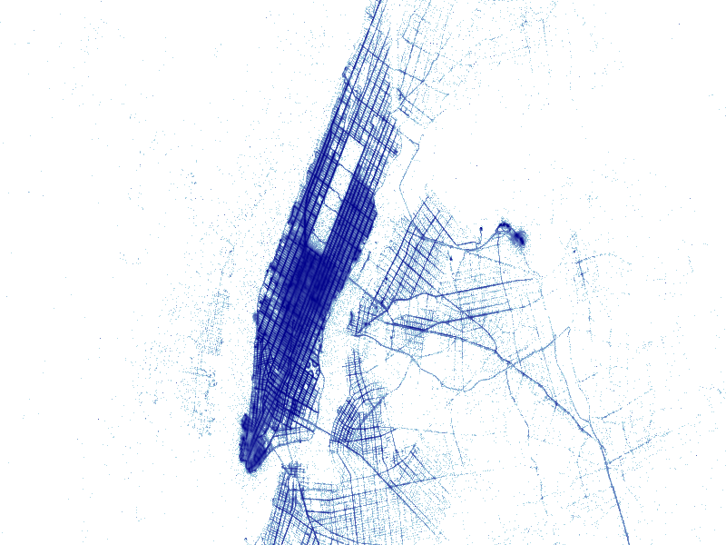
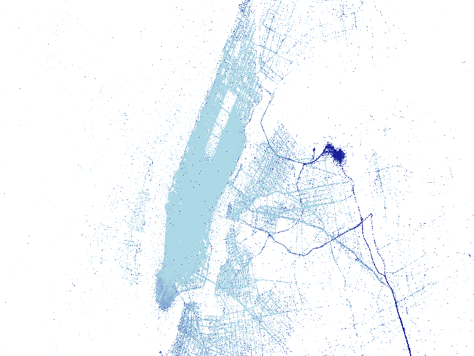

# Visualising large datasets with Datashader and HoloViews

:::{objectives}

- Understand why traditional plotting approaches struggle with large datasets.
- Learn the basic ideas behind Datashader's aggregation-based rendering model.
- Create static visualisations of millions of taxi pickup locations using Datashader.
- Use HoloViews and hvPlot to build interactive visualisations that remain
  responsive when exploring millions of records.
- Overlay aggregated data on geographic map tiles and use interactive
  exploration to discover patterns in the data.
:::

:::{questions}

- Why do scatter plots become both slow and difficult to interpret for large datasets?
- What does Datashader do differently from traditional plotting libraries?
- How can we visualise millions of taxi trips without reducing the dataset to a small sample?
- How can interactive visualisation remain responsive even when the underlying dataset is very large?
:::

## Motivation

The NYC Taxi dataset has become a classic example in data science and
visualisation. A single month of taxi trips contains more than ten million
records, each associated with a pickup location, a dropoff location,
timestamps, fares, distances, and other attributes.

Suppose we want to answer a simple question: where are taxis picked up in New
York City?

The most direct approach is to create a scatter plot of all pickup locations:

```python
df.plot.scatter(
    x="pickup_x",
    y="pickup_y"
)
```

This sounds reasonable, but for a sufficiently large dataset two problems
quickly appear: first, plotting becomes slow because the plotting library
attempts to draw enormous numbers of graphical objects. Second, the resulting
figure is often difficult to interpret. Dense regions become saturated with
points and important structures disappear beneath a cloud of overlapping
markers.

In this episode we will explore an alternative approach. Rather than plotting
every individual observation, we will aggregate observations into pixels and
visualise those aggregates. This gives us both better performance and, somewhat
surprisingly, more informative visualisations.

## The challenge of overplotting

Before introducing any new tools, it is worth reflecting on why a traditional
scatter plot struggles.

Imagine plotting more than ten million taxi pickup locations (we're doing it in
some minutes). At first sight it seems natural to draw more than ten million
points. However, the display only contains a finite number of pixels. Large
numbers of observations will inevitably fall into the same screen regions.

This leads to a number of problems:

- rendering becomes expensive,
- dense areas become visually saturated,
- regions with low density become difficult to distinguish,
- many individual markers are hidden behind other markers.

The figure may faithfully represent the data, yet reveal surprisingly little
about its structure. Thus, we are led to ask whether it's actually *desirable*
to plot every single point.

## Datashader's approach

[Datashader](https://datashader.org/) answers that question by changing how
visualisation is performed.

Rather than creating one graphical object for every observation, Datashader
divides the plotting area into pixels and computes statistics for each pixel.
The statistic might be:

- the number of observations,
- the mean value of a variable,
- the sum of a variable,
- some other aggregation.

Conceptually, the workflow looks like this: raw observations -> assign
observations to pixels -> aggregate values per pixel -> render image.

Because the number of pixels is fixed by the size of the display, visualisation
can remain practical even when the dataset contains millions or tens of
millions of rows.

An important consequence is that we no longer think primarily in terms of
plotting points. Instead, we think in terms of visualising aggregates.

## Loading the data

In this episode we will work with a dataset of **11.8 million yellow-taxi trips
from January 2015**. It is the same dataset that is used throughout the
[Datashader](https://datashader.org/) documentation (an old version of the one
we produced in the previous episode), and it is distributed as a ~370 MB
parquet file. The following snippet downloads it once and then loads it into a
Polars DataFrame:

```python
import urllib.request
from pathlib import Path

url = "https://s3.amazonaws.com/datashader-data/nyc_taxi_wide.parq"
archive = Path("nyc_taxi_wide.parq")

if not archive.exists():
    print("Downloading NYC taxi dataset (approx. 370 MB)...")
    urllib.request.urlretrieve(url, archive)
```

```python
import pandas as pd
import polars as pl

rides = pl.from_pandas(
    pd.read_parquet("nyc_taxi_wide.parq", engine="fastparquet")
)

rides.height
```

:::{note}

This parquet file was written with an old encoding that neither Polars nor
recent versions of pyarrow can decode, which is why we read it through
**fastparquet** (`pip install fastparquet`). Everything after this snippet is
pure Polars.

:::

The columns we will use are the pickup coordinates `pickup_x` and `pickup_y`,
the trip distance, and a `pickup_hour` column:

```python
rides.select(
    "pickup_x",
    "pickup_y"
).head()
```

:::{note}

This is a *pre-anonymisation* release of the taxi data: every trip carries the
**actual GPS coordinates** of its pickup and dropoff locations, projected to
web-mercator coordinates (EPSG:3857 — this is why the values are large numbers
like `-8235000`, not degrees). Since mid-2016 the TLC only publishes taxi zone
IDs instead of coordinates, so this older release is what all the classic
Datashader and HoloViews taxi examples are based on.

:::

::::{exercise} Inspect the dataset
Determine:

1. The number of rows.
2. The estimated size of the DataFrame in memory
   (hint: `rides.estimated_size("mb")`).
3. The minimum and maximum of `pickup_x` and `pickup_y`
   (hint: `rides.select(...).describe()`).

Do the coordinates look like sensible New York City locations?

:::{solution}

```python
print(f"rows          : {rides.height:,}")
print(f"estimated size: {rides.estimated_size('mb'):.0f} MB")

rides.select(
    "pickup_x",
    "pickup_y"
).describe()
```

:::
::::

## First attempt: a scatter plot

Before introducing Datashader, let us try the obvious solution: a plain
scatter plot of every pickup location, rendered with matplotlib.

```python
import hvplot.polars
import holoviews as hv

plot = rides.hvplot.scatter(
    x="pickup_x",
    y="pickup_y",
    alpha=0.1,
    width=700,
    height=500
)

fig = hv.render(plot, backend="matplotlib")
fig.set_size_inches(7, 5)
fig.savefig("scatter_mpl.png", dpi=150)
```

:::{note}

In a Jupyter notebook, the figure is displayed inline automatically. In a
plain Python REPL, however, nothing appears on screen: `hv.render` returns a
matplotlib `Figure` object, but the REPL has no display hook for figures.
Moreover, the returned figure is not registered with pyplot, so even
`plt.show()` or `fig.show()` will not display it. The `savefig` call above
writes the figure to `scatter_mpl.png`, which you can open with any image
viewer.

Also note that `width` and `height` are Bokeh-backend options and are ignored
when rendering with matplotlib; `set_size_inches` and `dpi` control the size
of the saved figure instead.

:::

Be patient when running this: depending on your machine, plotting 11.8 million
individual markers can take tens of seconds, which is part of why we would like
to move to a more performant approach. Moreover, the figure itself might look
disappointing:



### A note on Polars support

If you are using hvPlot, you can often work directly with Polars DataFrames as
in the example above. For many workflows this is the most convenient approach.

Internally, hvPlot currently performs conversions when working with Polars
data, since Polars is not yet a native HoloViews data interface. Most users do
not need to worry about these details, but it explains why examples in
documentation and tutorials sometimes convert data explicitly to Pandas before
visualisation.

For this lesson we will mostly use the direct Polars interface when possible
and discuss lower-level details only when they help explain how the system
works.

::::{danger}

Polars has a (experimental) `DataFrame.plot` interface which used to be a
wrapper for `hvplot`. In recent versions (>=1.6.0), the default plotting
package is instead [Altair](https://altair-viz.github.io/). To restore the old
`hvplot`-based behaviour, the user has to explicitly import `hvplot.polars` and
call `DataFrame.hvplot.scatter()`.

::::

## Static visualisation with Datashader

Datashader provides a different visualisation model based on aggregation.

We begin by creating a canvas that defines the output image resolution.

```python
import datashader as ds

canvas = ds.Canvas(
    plot_width=800,
    plot_height=600
)
```

We then aggregate pickup locations onto that canvas. Datashader works with
Pandas DataFrames, so we convert the two coordinate columns:

```python
coords = (
    rides
    .select(
        "pickup_x",
        "pickup_y"
    )
    .to_pandas()
)

agg = canvas.points(
    coords,
    "pickup_x",
    "pickup_y"
)
```

Notice that the result is not yet an image. It is an aggregated data structure
containing counts for each pixel. To transform it into a viewable image we
apply a colour mapping:

```python
from datashader import transfer_functions as tf

img = tf.shade(
    agg,
    cmap=["lightblue", "darkblue"]
)

img
```

:::{note}

In a Jupyter notebook, evaluating `img` renders the image automatically,
because datashader's image objects support the rich display protocol. In a
plain Python REPL the same line only prints a text summary of the underlying
array. To get a viewable image in the REPL, export it to a PNG file instead:

```python
ds.utils.export_image(img, "pickups")  # writes pickups.png
```

Then open `pickups.png` in an image viewer. The same applies to the shaded
images in the exercises below.

:::

Compare this figure with the matplotlib scatter plot: rendering took a small
fraction of the time, and individual streets, bridges and the street grid of
each borough are now clearly visible. All of that structure was present in the
scatter plot too: it was simply buried under overplotting.



:::{note}

The interactive parts of this episode (HoloViews with the Bokeh backend,
`datashade`, map tiles) are designed for a Jupyter notebook or JupyterLab,
where the figures are rendered inline in the browser. They cannot be displayed
directly in a plain Python REPL, so we use a workaround to open them in the
browser.

In the REPL this is harmless rather than an error: `hv.extension("bokeh")`
loads without complaint, and evaluating something like `datashade(points)`
simply prints a textual summary of the object and no figure appears. The
section on interactive visualisation below shows how to open the same plot
in a browser from a REPL, and for the static parts you can use the
matplotlib/static-datashader snippets above whenever you want a viewable
image.

:::

::::{exercise} Comparing resolutions
Create Datashader visualisations at two different resolutions:

- 400 × 300 pixels
- 1600 × 1200 pixels

Compare the resulting images.

:::{solution}

```python
small = ds.Canvas(
    plot_width=400,
    plot_height=300
)

large = ds.Canvas(
    plot_width=1600,
    plot_height=1200
)

agg_small = small.points(
    coords,
    "pickup_x",
    "pickup_y"
)

agg_large = large.points(
    coords,
    "pickup_x",
    "pickup_y"
)
```

:::
::::

### Beyond simple counts

So far each pixel represents the number of rides associated with that location,
so our first example is equivalent to the following:

```python
canvas.points(
    coords,
    "pickup_x",
    "pickup_y",
    agg=ds.count()
)
```

Datashader can aggregate other quantities as well. For example, suppose we want
to examine average trip distance spatially.

```python
agg_distance = canvas.points(
    rides.to_pandas(),
    "pickup_x",
    "pickup_y",
    agg=ds.mean("trip_distance")
)

img_distance = tf.shade(
    agg_distance,
    cmap=["lightblue", "darkblue"]
)

img_distance
```

Rendering this aggregation may reveal different spatial patterns than a density map:



### Other options and settings

#### Colouring

As we saw earlier, the mapping between a colour scale and the aggregated values is performed using the `tf.shade()` function. A colourmap can be prescribed with the `cmap` keyword argument; different colourmaps can help emphasise different structures. The `cmap` argument accepts either a list of colours or a *colormap object* — a bare string such as `"fire"` is interpreted as a single named colour and will raise `ValueError: Unknown color: 'fire'`. Datashader ships with the [colorcet](https://colorcet.holoviz.org/) collection of perceptually uniform colourmaps, and any matplotlib colormap works as well:

```python
import colorcet as cc
import matplotlib.pyplot as plt

tf.shade(agg, cmap=cc.cm["fire"])
tf.shade(agg, cmap=plt.get_cmap("viridis"))
tf.shade(agg, cmap=plt.get_cmap("inferno"))
```

Common choices for density plots include `fire`, `viridis` and `inferno`.

#### Linear and logarithmic scaling

Taxi pickups are not distributed uniformly across New York. For example,
Manhattan may have hundreds of times more pickups than other residential
neighbourhoods. Thus, with linear scaling (which is the default), the denser
areas dominate the image. If we use logarithmic scaling instead, we can inspect
in more detail the low-density regions:

```python
tf.shade(agg, how='log')
```

This is usually a useful first step to have a better grasp on a overly
concentrated density plot.

#### Histogram equalisation

Another useful option is [histogram
equalisation](https://en.wikipedia.org/wiki/Histogram_equalization), with which
colours are redistributed so as to have a more equalised distribution across
the image:

```python
tf.shade(agg, how='eq_hist')
```

#### Spreading

Sometimes, when zooming, sparse structures can be difficult to see. This is due
to the very nature of datashader plotting: each pixel represents aggregate
values, so sparse points are reduced to single pixels. To counteract this
phenomenon, datashader provides functions as `spread()` or `dynspread()` which
make help *spreading* smaller datapoints.

::::{exercise}

Create different types of visualisations using the techniques we introduced:
linear, logarithmic, histogram equalisation and (dynamic) spreading). Try to
find the most optimal (for your case) visualisation.

:::{solution}

```python
from datashader import transfer_functions as tf
import colorcet as cc

linear = tf.shade(
    agg,
    cmap=cc.cm["fire"],
    how="linear",
)

log = tf.shade(
    agg,
    cmap=cc.cm["fire"],
    how="log",
)

eq_hist = tf.shade(
    agg,
    cmap=cc.cm["fire"],
    how="eq_hist",
)

eq_hist_dyn = tf.dynspread(
    tf.shade(
        agg,
        cmap=cc.cm["fire"],
        how="eq_hist",
    )
)

linear
```

```python
log
```

```python
eq_hist
```

```python
eq_hist_dyn
```

:::

::::

#### Further options

Datashader supports many other options, such as transparency control and
category-based aggregation. Further information can be found in the
[documentation](https://datashader.org/user_guide/index.html).

## Interactive visualisation with HoloViews

Static figures are useful, but exploratory analysis often involves repeatedly
zooming, panning, and filtering.

The HoloViz ecosystem combines particularly well with Datashader because
aggregation can be performed dynamically as the user explores the data.

Start by enabling the HoloViews backend.

```python
import holoviews as hv

hv.extension("bokeh")
```

Next construct a set of points.

```python
points = hv.Points(
    coords,
    kdims=[
        "pickup_x",
        "pickup_y"
    ]
)
```

For small datasets we could display these points directly:

```python
points
```

For large datasets it is more effective to datashade them.

```python
from holoviews.operation.datashader import datashade

datashade(points)
```

Try zooming into different parts of the figure.

:::{note}

In a Jupyter notebook the figure above is displayed inline and is fully
interactive. To get the same experience in a plain Python REPL, serve the
plot with Panel (which is installed together with HoloViews):

```python
import panel as pn

server = pn.panel(datashade(points)).show(threaded=True)
```

`.show()` starts a small local web server and opens the plot in your
browser (`threaded=True` is important in a REPL, otherwise the call blocks
the prompt). Zooming and panning re-runs the datashader aggregation live,
exactly as in a notebook. The server keeps running until you call
`server.stop()` or exit Python.

The same works for the map-tiles plot below, e.g.
`pn.panel(tiles_plot).show(threaded=True)`.

:::

One of the key ideas behind this workflow is that the visualisation is
recomputed when the viewport changes. Rather than plotting all observations at
all scales, the visualisation is adapted to the current view.

## Adding geographic context

Longitude and latitude become much easier to interpret when shown together with
a background map.

One of the most striking visualisations in the HoloViz ecosystem combines
Datashader aggregation with web map tiles.

```python
import hvplot.polars

tiles_plot = rides.hvplot.points(
    x="pickup_x",
    y="pickup_y",
    rasterize=True,
    tiles=True,
    cmap="fire",
    alpha=0.7,
    frame_width=800,
    frame_height=600,
)
```

:::{note}

Map tiles are downloaded from the internet, so this example requires a
network connection (and a Jupyter notebook, or
`pn.panel(tiles_plot).show(threaded=True)` in a REPL as explained above).

:::

The visualisation now combines two pieces of information:

- geographic context from the map,
- taxi activity from the datashaded aggregation.

At city scale we immediately see where activity is concentrated. As we zoom
further in, neighbourhood-level and street-level structures begin to appear.

This is often the first point in the lesson where participants experience the
full benefit of the Datashader approach. Millions of observations can be
explored interactively without first reducing the dataset to a small sample.

::::{exercise} Day vs night

Taxi activity changes dramatically throughout the day.

The dataset already contains a `pickup_hour` column. Use it to create
separate visualisations for daytime (6:00–18:59) and nighttime rides.

Questions to investigate:

- Which areas are busy throughout the day?
- Which areas become more important at night?
- Do airports appear differently during different periods of the day?

::::

::::{solution}

```python
day = rides.filter(
    pl.col("pickup_hour").is_between(6, 18)
)

night = rides.filter(
    ~pl.col("pickup_hour").is_between(6, 18)
)
```

Create separate datashaded visualisations and compare them side by side.
::::

::::{exercise} Exploratory data analysis

At this stage we have all of the building blocks needed to perform exploratory
visualisation on a large dataset.

Let us consider a question that can be investigated using the taxi dataset, for
example:

- How do pickup locations vary with time of day?
- Are different trip distances associated with different parts of the city?
- Which locations generate the longest average trips?
- How does weekend activity differ from weekday activity?

Create one visualisation that helps answer your question.

::::

## Summary

A common reaction when large visualisations become slow is to look for faster
hardware or more efficient plotting libraries. Datashader takes a different
approach. Instead of attempting to draw every observation, it focuses on
visualising meaningful aggregates.

For geographic datasets such as NYC Taxi trips, this often leads not only to
better performance but also to more informative figures. Patterns that are
difficult to see in traditional scatter plots become immediately visible once
observations are aggregated into a density map.

Combined with HoloViews and hvPlot, Datashader makes it possible to explore
datasets containing millions of records interactively, without reducing them to
a tiny sample.

:::{keypoints}

- Large datasets often require different visualisation strategies rather than
  simply faster plotting.
- Overplotting is both a performance problem and a visualisation problem.
- Datashader aggregates observations into pixels before rendering.
- HoloViews and hvPlot provide an interactive interface on top of Datashader.
- Geographic map tiles provide useful context when exploring spatial data.
- Interactive aggregation allows exploration of datasets that would otherwise
  be difficult to visualise directly.

:::
